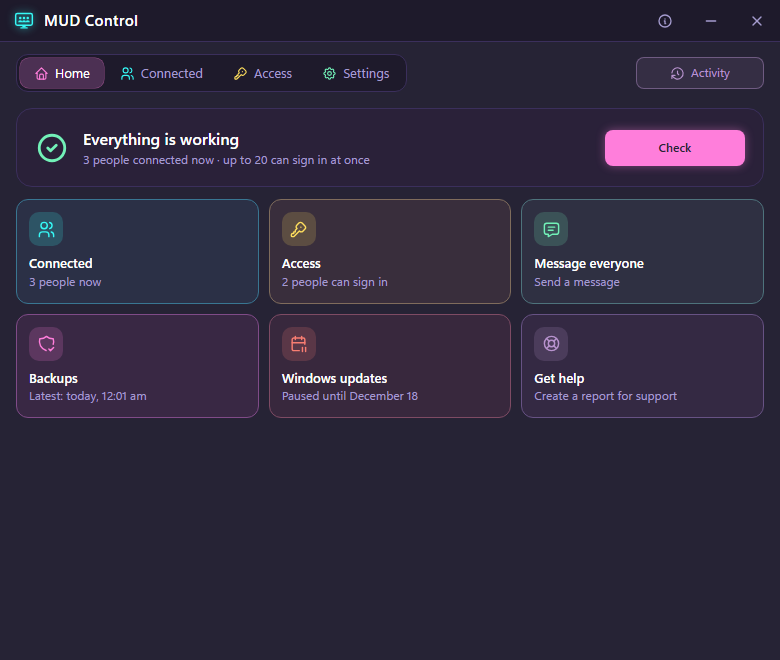
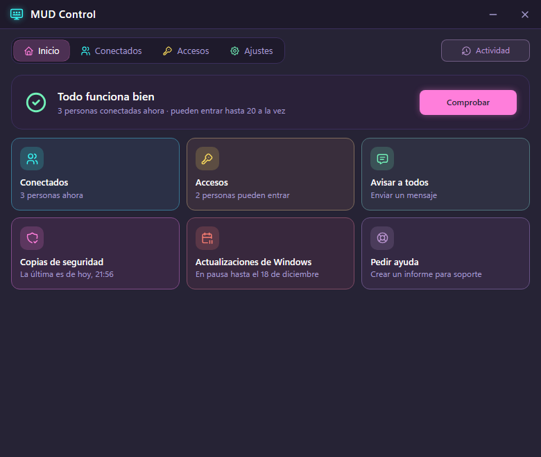
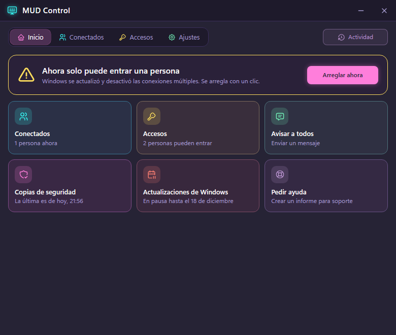
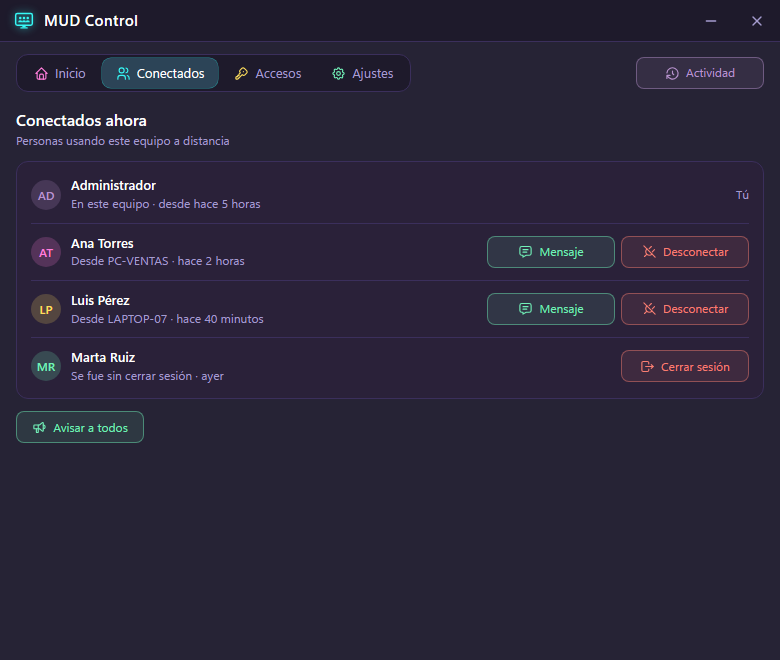
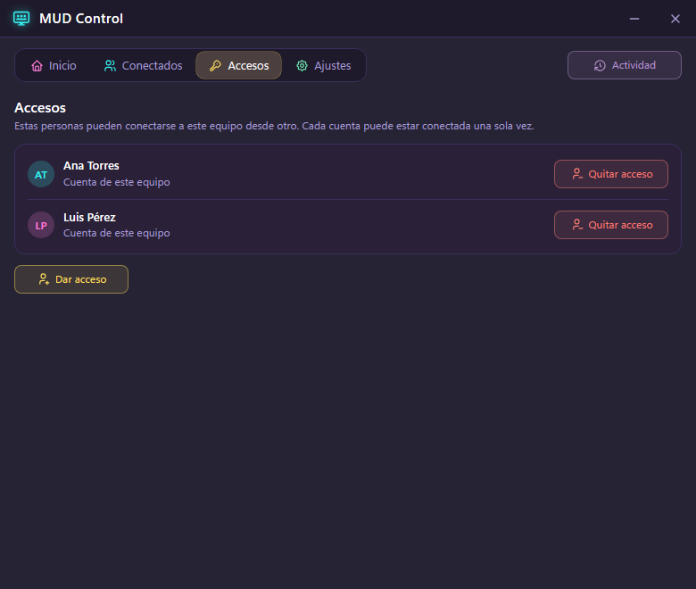
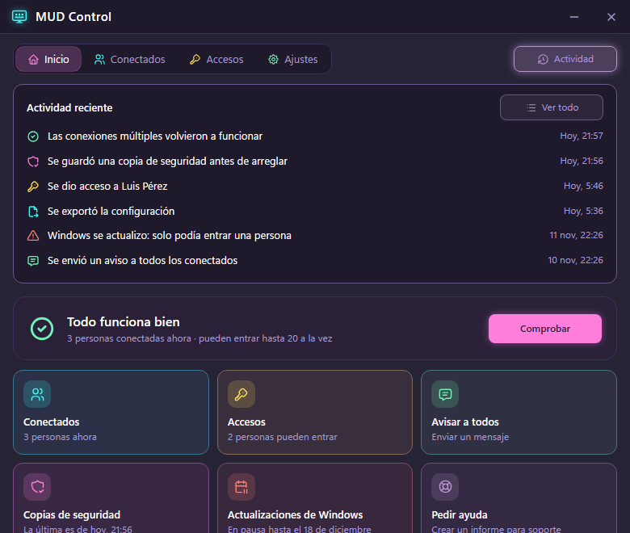
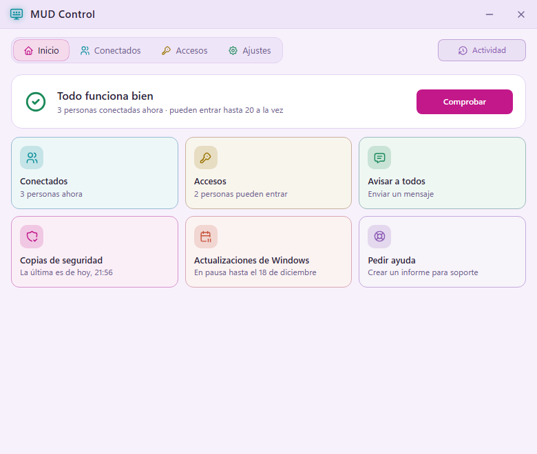
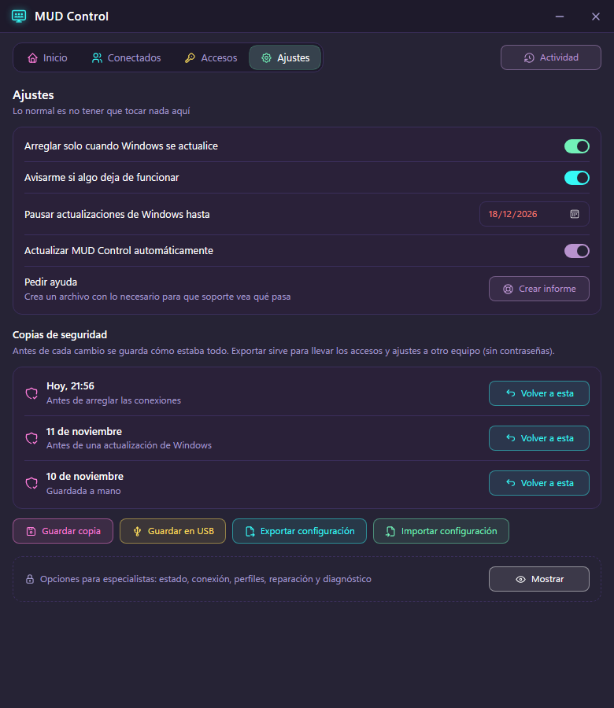
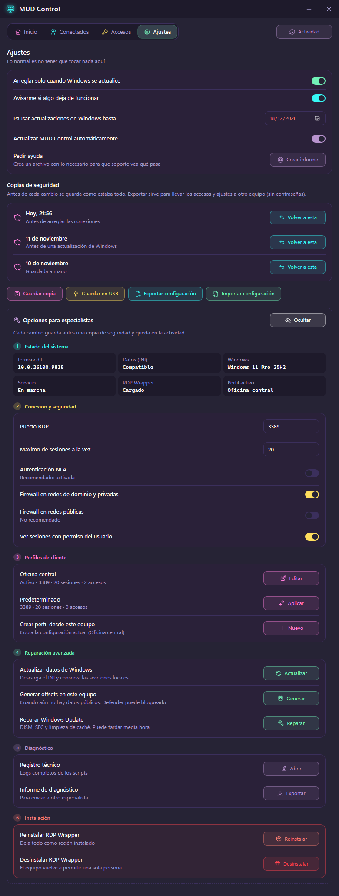

<div align="center">
  <picture>
    <source media="(prefers-color-scheme: dark)" srcset="docs/images/mud-control-logo-dark.svg" />
    
  </picture>
  <h1>MUD Control: Multi User Desktops Control</h1>

  <p><a href="README.md">Español</a> · <b>English</b></p>

  <a href="https://github.com/borferkic/MUD-Control/releases/latest"></a>
  <a href="https://github.com/borferkic/MUD-Control/commits/master"></a>
  
  <a href="LICENSE"></a>
</div>

## What it is

**MUD Control** lets **several people connect at the same time** through Remote Desktop to a
**Windows 11 Pro** computer, and keeps it working when Windows updates.

Windows 11 Pro allows only one remote session. MUD Control uses
[RDP Wrapper Library](https://github.com/stascorp/rdpwrap) (Stas'M Corp., Apache-2.0) to lift
that limit, and adds what it lacks for everyday use:

- **A desktop app anyone can use**: it says in one sentence whether everything works and, if a
  Windows update broke something, fixes it with one button.
- **Automatic repair** after every Windows update.
- **Backups** before every change, so you can go back.
- **Client profiles** to take the same setup to other computers.
- **Works offline**: the app ships with the latest `termsrv.dll` data.

<div align="center">
  
</div>

> [!IMPORTANT]
> **Each account can be connected only once.** Several people can be connected at the same time,
> each with their own account. Someone who signs in with an account that's already connected
> gets that session back instead of opening a new one. MUD Control always enforces this.

## Screenshots

| Everything works | Windows updated |
|---|---|
|  |  |

| Connected | Access |
|---|---|
|  |  |

| Activity | Light mode |
|---|---|
|  |  |

| Settings and backups | Specialist options |
|---|---|
|  |  |

The app follows the Windows light or dark theme, uses the Synthwave '84 palette, and comes in
**English and Spanish**: it uses the Windows language, and you can change it in **Settings → Language**.

## Installation

1. Download `MUD-Control_x.y.z_x64-setup.exe` from the [latest release](https://github.com/borferkic/MUD-Control/releases/latest).
2. Run it from an administrator account. The installer includes everything and doesn't need Internet.
3. Open **MUD Control** and press **Install** on the home screen to set up RDP Wrapper.

> [!WARNING]
> **Antivirus.** Microsoft Defender often flags `rdpwrap.dll` as a *HackTool*. Setup asks to add
> an exclusion only for `C:\Program Files\RDP Wrapper`. Weigh the risk first.

## How to use it

| Tab | What it's for |
|---|---|
| **Home** | Status in one sentence. If Windows turned off multiple connections, **Fix now** appears. |
| **Connected** | Who is using the computer and from where. Send a message, sign someone out, or close a stuck session. |
| **Access** | Which accounts can connect. Grant or remove access. |
| **Settings** | Automatic repair, alerts, pausing Windows Update, backups, exporting and importing the setup, app updates. |
| **Activity** | Button at the top right: a plain-language history of everything that happened. |

**Specialist options** sit at the end of Settings, closed by default, grouped from least to most
sensitive: system status, connection and security, client profiles, advanced repair, diagnostics,
and installation.

The full explanation of every feature and how it works inside is in
[**docs/como-funciona.md**](docs/como-funciona.md) (Spanish).

## App updates

MUD Control checks GitHub releases for new versions at startup and every 6 hours. With
**Settings → Update MUD Control automatically** on, it installs the update by itself when nobody
is connected; otherwise it lets you know, and you update with **Settings → Check for updates →
Update now** (also from the tray icon). Every version is signed, and the app rejects any file
without that signature. Installs older than 2.2.0 need one manual update.

## Offline

Everything works offline except four things, which warn you when there's no Internet:
fetching data for a `termsrv.dll` newer than the bundled one, generating offsets,
repairing Windows Update (DISM), and updating the app itself.

## Repository layout

| Folder | Contents |
|---|---|
| `app/` | The desktop app: Tauri 2 + React + Radix Primitives + Tailwind. See [app/README.md](app/README.md). |
| `app/src-tauri/resources/backend.ps1` | All app logic, in PowerShell. |
| `mud/scripts/` | `fix-rdpwrap.bat` (repair after Windows Update), `reparar-windowsupdate.bat`, `bloquear-actualizaciones.bat`. |
| `mud/kit/` | Classic menu-driven installer (`instalar.bat` + `kit.ps1`), no GUI. |
| `mud/perfiles/` | Client profiles in JSON (same format the app exports). |
| `mud/patches/` | Our own `termsrv.dll` offsets, for example `10.0.26100.9818`. |
| `res/rdpwrap.ini` | Updated INI: community data plus MUD Control patches. Bundled with the app. |
| `branding/` | Logo, icons, and the script that generates them. |

### Scripts without the app

```bat
:: Repair after a Windows update (as administrator)
mud\scripts\fix-rdpwrap.bat

:: Also register the self-repair task (at Windows startup and daily at 07:00)
mud\scripts\fix-rdpwrap.bat /tarea

:: If no public source supports the version yet: generate offsets locally
mud\scripts\fix-rdpwrap.bat /finder
```

`fix-rdpwrap.bat` exit codes: `0` OK · `7` no data for this version yet ·
`8` antivirus blocked the generator · `2/3` RDP Wrapper not installed.

## Notes

- **Windows licensing:** multiple simultaneous sessions on Windows Pro isn't a scenario Microsoft
  supports. The supported route is Windows Server with RDS licenses.
- **Security:** NLA is on by default and the firewall opens only on domain and private networks.
  Don't give Remote Desktop accounts administrator rights.

## Credits

- RDP Wrapper Library: Stas'M Corp. and contributors (binarymaster). Its original README is in
  [README-rdpwrap.md](README-rdpwrap.md).
- Community INI: sebaxakerhtc, affinityv, asmtron.
- RDPWrapOffsetFinder: llccd.
- Color palette inspired by Robb Owen's Synthwave '84 theme.
