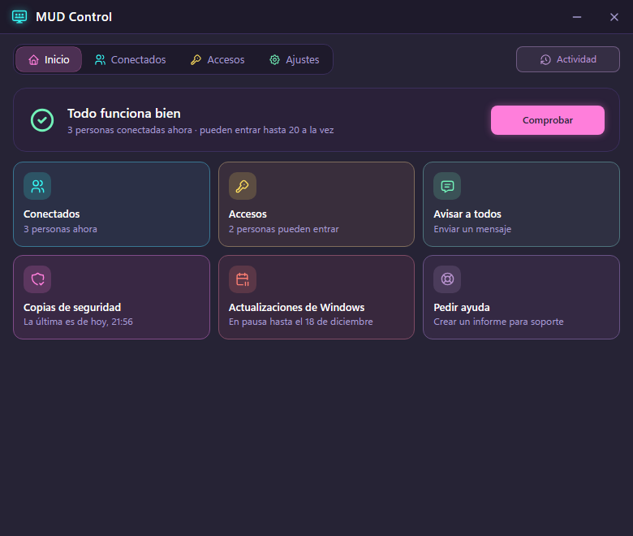
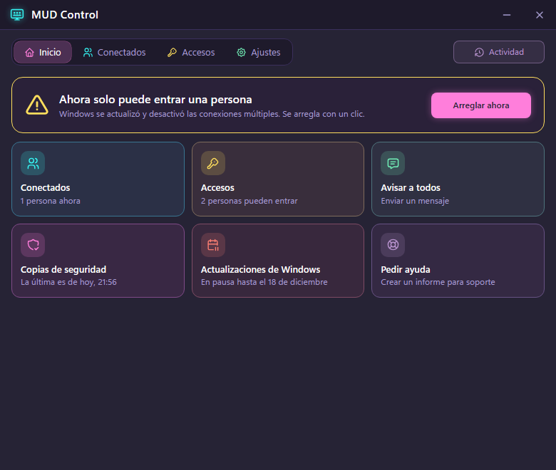
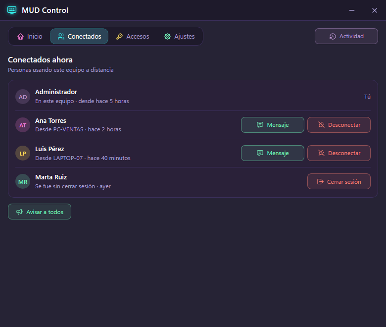
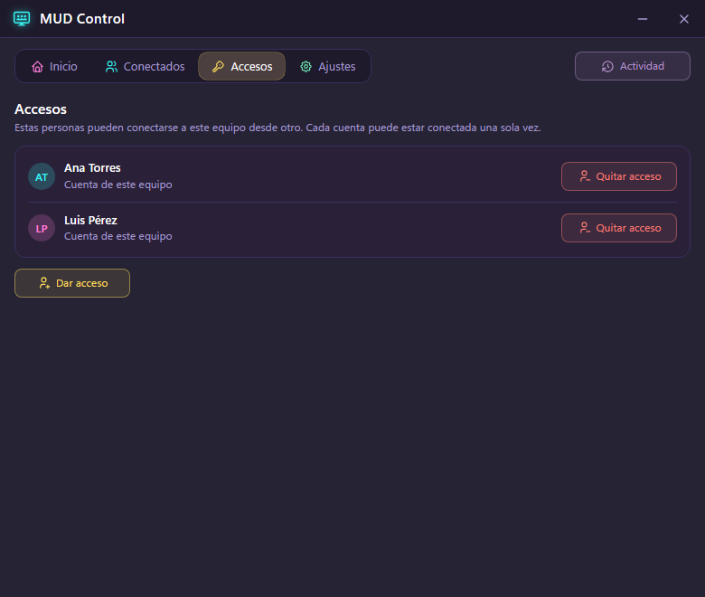
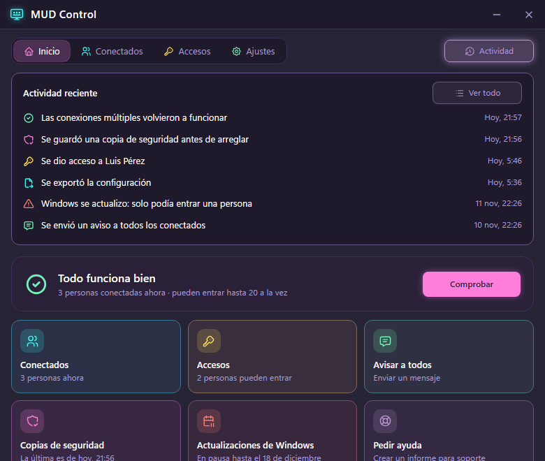
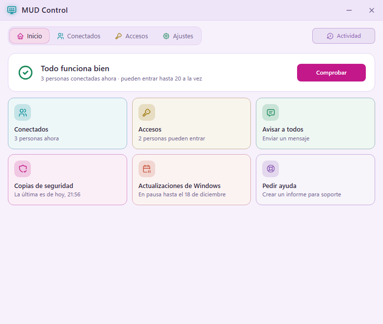
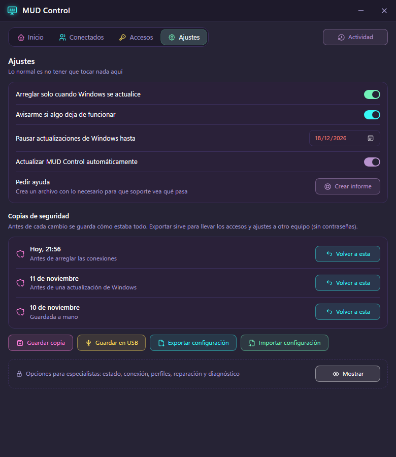
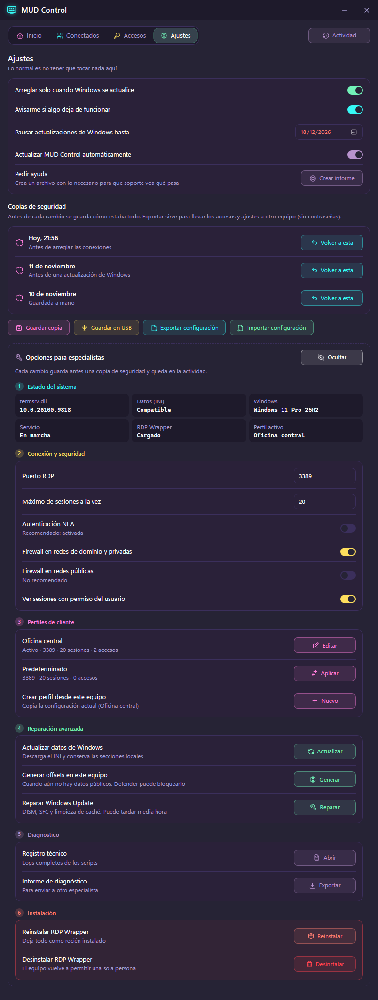

<div align="center">
  <picture>
    <source media="(prefers-color-scheme: dark)" srcset="docs/images/mud-control-logo-dark.svg" />
    
  </picture>
  <h1>MUD Control: Multi User Desktops Control</h1>

  <a href="https://github.com/borferkic/MUD-Control/releases/latest"></a>
  <a href="https://github.com/borferkic/MUD-Control/commits/master"></a>
  
  <a href="LICENSE"></a>
</div>

## Qué es

**MUD Control** permite que **varias personas se conecten a la vez** por Escritorio remoto a un
equipo con **Windows 11 Pro**, y lo mantiene funcionando cuando Windows se actualiza.

Windows 11 Pro solo admite una sesión remota. MUD Control usa
[RDP Wrapper Library](https://github.com/stascorp/rdpwrap) (Stas'M Corp., Apache-2.0) para
ampliarlo, y añade lo que le falta para el día a día:

- **Una app de escritorio pensada para cualquier persona**: dice en una frase si todo funciona y,
  si Windows rompió algo, se arregla con un botón.
- **Reparación automática** después de cada actualización de Windows.
- **Copias de seguridad** antes de cada cambio, para poder volver atrás.
- **Perfiles de cliente** para llevar la misma configuración a otros equipos.
- **Funciona sin Internet**: la app trae dentro los datos más recientes de `termsrv.dll`.

<div align="center">
  
</div>

> [!IMPORTANT]
> **Cada cuenta puede estar conectada una sola vez.** Pueden entrar varias personas a la vez,
> pero cada una con su propia cuenta. Si alguien entra con una cuenta que ya está conectada,
> recupera esa sesión en lugar de abrir otra. MUD Control lo aplica siempre y no se puede cambiar.

## Capturas

| Todo funciona | Windows se actualizó |
|---|---|
|  |  |

| Conectados | Accesos |
|---|---|
|  |  |

| Actividad | Modo claro |
|---|---|
|  |  |

| Ajustes y copias de seguridad | Opciones para especialistas |
|---|---|
|  |  |

La app sigue el tema claro u oscuro de Windows, con la paleta Synthwave '84.

## Instalación

1. Descarga `MUD Control_x.y.z_x64-setup.exe` de la [última versión](https://github.com/borferkic/MUD-Control/releases/latest).
2. Ejecútalo con una cuenta de administrador. El instalador incluye todo lo necesario y no pide Internet.
3. Abre **MUD Control**. La primera vez, un especialista debe hacer la instalación de RDP Wrapper
   desde **Ajustes → Opciones para especialistas → Instalación → Reinstalar**.

> [!WARNING]
> **Antivirus.** Microsoft Defender suele marcar `rdpwrap.dll` como *HackTool*. La instalación
> pide agregar una exclusión solo para `C:\Program Files\RDP Wrapper`. Evalúa el riesgo antes.

## Cómo se usa

| Pestaña | Para qué sirve |
|---|---|
| **Inicio** | Estado en una frase. Si Windows desactivó las conexiones múltiples aparece **Arreglar ahora**. |
| **Conectados** | Quién está usando el equipo y desde dónde. Enviar un mensaje, desconectar o cerrar una sesión colgada. |
| **Accesos** | Qué cuentas pueden conectarse. Dar o quitar acceso. |
| **Ajustes** | Reparación automática, avisos, pausa de Windows Update, copias de seguridad, exportar e importar la configuración. |
| **Actividad** | Botón arriba a la derecha: historial de todo lo que pasó, en palabras sencillas. |

Las **Opciones para especialistas** están al final de Ajustes, cerradas por defecto, y se agrupan
de menos a más delicado: estado del sistema, conexión y seguridad, perfiles de cliente,
reparación avanzada, diagnóstico e instalación.

La explicación completa de cada función y de cómo trabaja por dentro está en
[**docs/como-funciona.md**](docs/como-funciona.md).

## Sin Internet

Todo funciona sin conexión salvo cuatro cosas, que avisan si no hay Internet:
buscar datos nuevos para una `termsrv.dll` más reciente que la incluida, generar offsets,
reparar Windows Update (DISM) y actualizar la propia app.

## Estructura del repositorio

| Carpeta | Contenido |
|---|---|
| `app/` | La app de escritorio: Tauri 2 + React + Radix Primitives + Tailwind. Ver [app/README.md](app/README.md). |
| `app/src-tauri/resources/backend.ps1` | Toda la lógica de la app en PowerShell. |
| `mud/scripts/` | `fix-rdpwrap.bat` (reparar tras Windows Update), `reparar-windowsupdate.bat`, `bloquear-actualizaciones.bat`. |
| `mud/kit/` | Instalador clásico con menú (`instalar.bat` + `kit.ps1`), sin interfaz gráfica. |
| `mud/perfiles/` | Perfiles de cliente en JSON (mismo formato que exporta la app). |
| `mud/patches/` | Offsets propios de `termsrv.dll`, por ejemplo `10.0.26100.9818`. |
| `res/rdpwrap.ini` | INI actualizado: datos de la comunidad + parches de MUD Control. La app lo incluye. |
| `branding/` | Logo, iconos y el script que los genera. |

### Scripts sin la app

```bat
:: Reparar después de una actualización de Windows (como administrador)
mud\scripts\fix-rdpwrap.bat

:: Además registrar la tarea de autorreparación (al iniciar Windows y diaria a las 07:00)
mud\scripts\fix-rdpwrap.bat /tarea

:: Si ninguna fuente pública soporta la versión: generar offsets localmente
mud\scripts\fix-rdpwrap.bat /finder
```

Códigos de salida de `fix-rdpwrap.bat`: `0` OK · `7` aún no hay datos para esta versión ·
`8` el antivirus bloqueó el generador · `2/3` RDP Wrapper no instalado.

## Notas

- **Licencias de Windows:** varias sesiones simultáneas en Windows Pro no es un escenario soportado
  por Microsoft. Lo soportado es Windows Server con licencias RDS.
- **Seguridad:** NLA viene activada por defecto y el firewall solo se abre en redes de dominio y
  privadas. No des permisos de administrador a las cuentas de Escritorio remoto.

## Créditos

- RDP Wrapper Library: Stas'M Corp. y colaboradores (binarymaster). Su README original está en
  [README-rdpwrap.md](README-rdpwrap.md).
- INI de la comunidad: sebaxakerhtc, affinityv, asmtron.
- RDPWrapOffsetFinder: llccd.
- Paleta de colores inspirada en el tema Synthwave '84 de Robb Owen.
